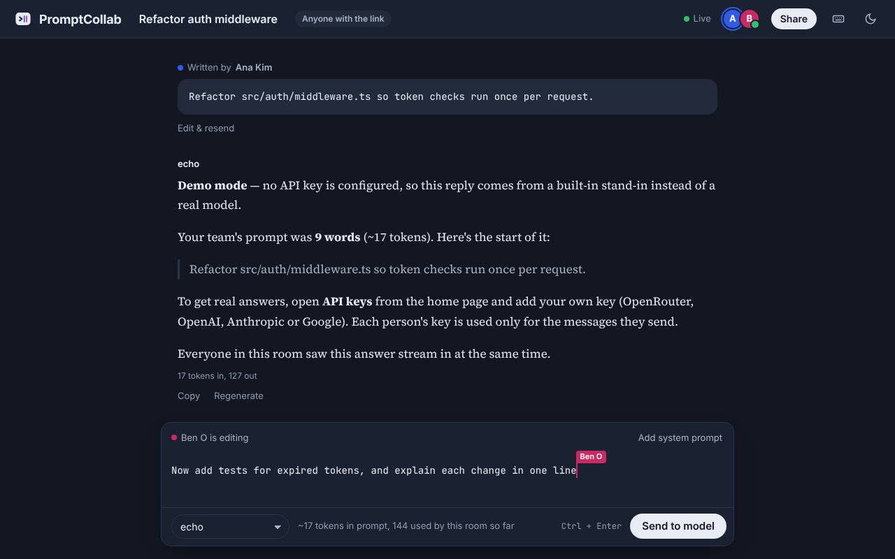
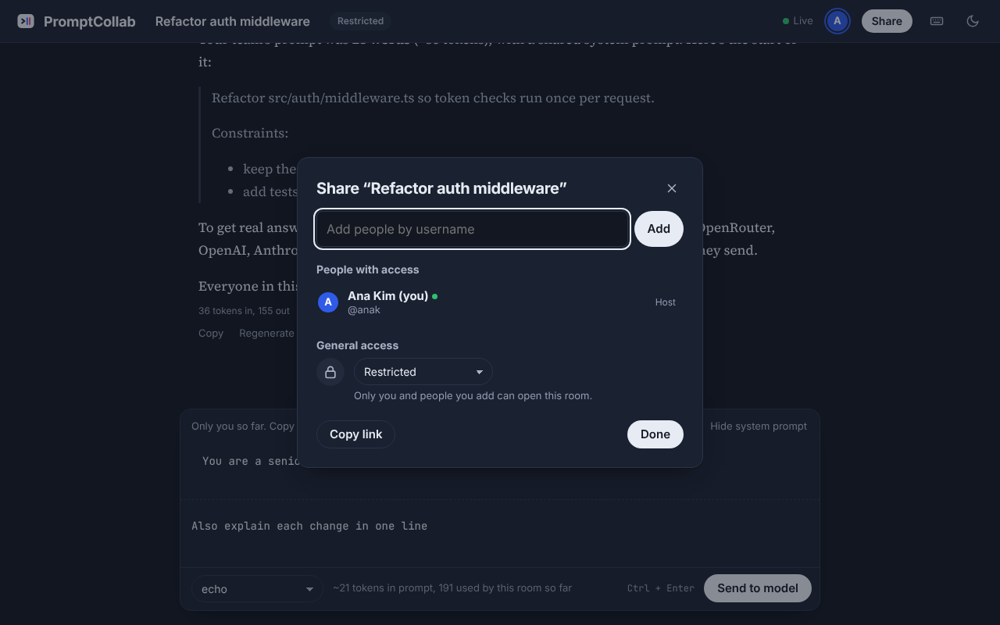
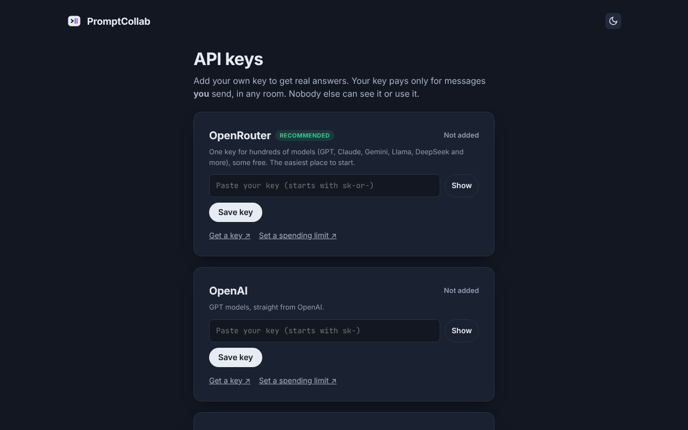

# PromptCollab

[](https://github.com/Supey1/prompt-collab/actions/workflows/test.yml)
[](LICENSE)

Write one AI prompt together, in real time, then send it to any model.

Teams share a room link. Everyone edits the same prompt live, like a shared doc, with name-tagged cursors. When the prompt is ready, anyone sends it to the model the room has picked, whether that's GPT, Claude, Gemini, or any of the hundreds of models on OpenRouter. The reply streams to everyone in the room at once.



## Features

- **Live co-editing** with name-tagged cursors (operational transformation, fuzz-tested)
- **Any model**: OpenAI, Anthropic, Google, or hundreds via OpenRouter, plus a free demo model
- **Bring your own key**: each person's key pays only for what they send, encrypted at rest
- **Accounts** with profile pictures, contacts, and recovery codes instead of email resets
- **Google Docs-style sharing**: every room has a host, who adds or removes people and picks *Restricted* or *Anyone with the link*
- **Math that reads like math**: LaTeX in replies (`$...$`, `$$...$$`, `\(...\)`, `\[...\]`, `\begin{align}`) is rendered with KaTeX, loaded only when a reply has math
- **Regenerate, edit & resend, copy, undo clear, and export** a conversation as Markdown
- **Keyboard shortcuts** (press `?` in a room) and a first-visit walkthrough
- **Download my data** and **delete account**, and a plain-English [privacy page](public/privacy.html)
- **Dark mode**, works on phones, and passes an automated accessibility audit (axe, WCAG 2.1 AA) in both themes
- **No dependencies, no trackers**: plain Node.js, fonts served locally

| Share a room | Bring your own key |
| --- | --- |
|  |  |

## Run it

You need [Node.js](https://nodejs.org) 20 or newer. There's nothing to install: the app has no dependencies.

```bash
git clone https://github.com/Supey1/prompt-collab
cd prompt-collab
npm start            # or: node server/index.js
```

Open http://localhost:3000, click **Sign up** to create an account, then click **Start a room**. To try the collaboration on one computer, open the room link in a private window and sign up as a second person there.

Until someone adds their own API key, the app runs in **demo mode**: a built-in stand-in model replies, so you can try the collaboration before setting anything up.

## Use it on your home network

The server already accepts connections from other devices on the same Wi-Fi. When it starts, it prints the address to share:

```
PromptCollab running at http://localhost:3000
  On your network:   http://192.168.1.23:3000
```

Open that address on another phone or laptop on the same network. **Copy invite link** uses the network address automatically, even when you opened the app as `localhost`.

If other devices can't connect, your computer's firewall is probably blocking Node.js. On Windows, allow Node.js on **Private** networks when asked, or under *Windows Defender Firewall → Allow an app*. On macOS, allow incoming connections for `node` under *System Settings → Network → Firewall → Options*.

## Add real models (bring your own key)

Each person adds their own key on the **API keys** page (`/keys`, linked from the home page header) for any of:

| Provider | Gives you |
| --- | --- |
| OpenRouter | Hundreds of models (GPT, Claude, Gemini, Llama, DeepSeek and more) through one key. Easiest place to start. |
| OpenAI | GPT models |
| Anthropic | Claude models |
| Google | Gemini models |

**Free models, no card needed:** OpenRouter's free models (IDs ending in `:free`, priced $0) appear in their own **Free** group at the top of the model menu, well-known chat models first; free models that can't chat (safety classifiers) are hidden. A free OpenRouter account gives each person 50 messages a day on them. Free models are often busy, so each request also lists up to two other *free* models for OpenRouter to fall back on, and the reply shows which model answered.

**Optional house key:** set `OPENROUTER_HOUSE_KEY` to your own free OpenRouter key, and people *without* a key can use the free models too: `HOUSE_DAILY_PER_PERSON` messages each (default 5) per UTC day, out of `HOUSE_DAILY_TOTAL` (default 50, OpenRouter's free limit). The house key is only ever used for free models, never reaches a browser, and failed messages don't count. Set its credit limit to 0 on OpenRouter as a backstop; the server warns at startup if you haven't.

**Whoever presses Send pays, with their own key.** A key is never used for anyone else's messages, and nobody else can see it. The model menu shows the models your keys unlock, read from each provider's live model list.

How keys are protected:
- **Encrypted at rest** with AES-256-GCM in `data/keys.json`, separate from accounts. Each entry is bound to its owner and provider, so it can't be moved to another account.
- **Never sent back to the browser.** The page only shows the last 4 characters.
- **Checked with the provider before saving**, and format-checked so a key is only ever sent to the company that issued it.
- **Removed from provider error messages** before they're shown to the room or written to the log.
- **Only accepted over `https://` or on the computer running the server.** On a plain `http://` network address anyone on the same Wi-Fi could read a key in transit (see `ALLOW_INSECURE_KEYS`).
- **Rate-limited key checks**, so the server can't be used to test stolen keys in bulk.

Settings (`.env`):

| Variable | Default | Meaning |
| --- | --- | --- |
| `OPENROUTER_HOUSE_KEY` | none | Your free OpenRouter key, to give people without a key a few free messages a day on free models |
| `HOUSE_DAILY_PER_PERSON` | `5` | Free messages per person per day with the house key |
| `HOUSE_DAILY_TOTAL` | `50` | Free messages per day in total (OpenRouter's free accounts allow 50) |
| `KEY_ENCRYPTION_SECRET` | auto | Encrypts saved keys. If empty, a random one is created in `data/secret.key`. **Set it explicitly when you deploy**, keep it secret, and don't change it, or saved keys must be re-entered. |
| `PORT` | `3000` | Port to listen on |
| `ACCESS_CODE` | none | If set, people must also enter this code to join a room |
| `ALLOW_INSECURE_KEYS` | none | Set to `1` to allow adding keys over plain `http://` network addresses. Only on a home network you trust. |
| `DATA_DIR` | `./data` | Where everything is saved |
| `DISABLE_DEMO` | none | Set to `1` to hide the free demo model |

### Other security measures
- Passwords hashed with `scrypt`. Sessions are HttpOnly, SameSite cookies, and only a hash is stored on the server.
- Requests that change anything must come from the app's own pages (CSRF protection), and live connections check the same.
- A strict Content Security Policy (only the app's own scripts run), no framing (clickjacking), `nosniff`, no referrer, and `no-store` on private API responses.
- Rate limits on sign-in attempts, new accounts, and key checks.
- Fonts ship with the app in `public/fonts/` (Inter, Source Serif 4, JetBrains Mono; SIL Open Font License), so no third-party font service sees your visitors.

## How it works

```
browser ── WebSocket ──► server/index.js
  │                         │
  ├ editor.js               ├ accounts.js   sign up / sign in, password hashing, sessions
  │                         ├ keys.js       everyone's API keys, encrypted at rest
  │                         ├ rooms.js      one Room per link: shared text, thread, model, usage
  │  (textarea + cursors)   ├ doc.js        orders every edit (operational transformation)
  ├ doc-client.js           ├ providers.js  OpenAI / Anthropic / Gemini / OpenRouter / demo
  └ shared/ot.js ◄──────────┘ ws.js         minimal WebSocket server
```

- **Live editing** uses operational transformation (`public/shared/ot.js`). The server is the single source of truth: it puts concurrent edits in order and transforms each one so every person ends up with identical text. `npm test` fuzz-tests this with simulated clients editing at the same time.
- **Sending:** the server takes the shared prompt and the optional shared system prompt, adds the conversation so far, and streams the model's reply to everyone. Only one request runs per room at a time, so a team never pays twice for the same question.
- **Credit:** each sent message records who helped write it and who sent it.
- **Accounts:** everyone signs in before starting or joining a room, and their display name, color and picture come from their account. Passwords are stored only as salted `scrypt` hashes. Signing in sets an HttpOnly cookie that lasts 30 days, and the server keeps only a hash of it.
- **Hosts and sharing:** whoever creates a room hosts it. New rooms are *Restricted*: only the host and people they add can open them. The host's **Share** button adds people (contacts or any username), removes them, lets in people who asked for access, and can switch the room to *Anyone with the link*. Someone the host removes can't come back through the link until the host adds them again.
- **Contacts:** send a request by username from the account page (`/account`); the other person accepts or declines. Contacts appear as quick picks in Share.
- **Storage:** everything is saved in `data/` (never committed to git):
  - `data/rooms/<room>.json`: one file per room, including its host and who has access
  - `data/users.json`: accounts
  - `data/sessions.json`: who is signed in
  - `data/avatars/`: profile pictures
  - `data/keys.json`: everyone's API keys, encrypted
  - `data/house-usage.json`: today's free message counts, if the house key is on
  - `data/secret.key`: the encryption key for them, unless `KEY_ENCRYPTION_SECRET` is set

## Deploying

Any host that runs a long-lived Node process with WebSockets works, such as Render, Railway, Fly.io, or a small VPS. Set `KEY_ENCRYPTION_SECRET` (and optionally `ACCESS_CODE`) as environment variables there, serve it over `https://`, and give it a persistent disk for `data/`. Serverless platforms like Vercel or Netlify functions don't keep WebSocket connections open, so they won't work for this app as written.

## Tests

```bash
npm test
```

- `test/ot.test.js` fuzz-tests the live editing: simulated people type at once and must end up with identical text.
- `test/markdown.test.js` checks which parts of a reply count as LaTeX math (and that prices like "$5 and $10", code, and HTML don't).
- `test/server.test.js` starts a real server with an empty data folder and checks pages, security headers, link previews, sign-up, CSRF protection, password reset with recovery codes, data export, and account deletion.

GitHub Actions runs both on Node 20 and 22 for every push and pull request.

## License

[MIT](LICENSE). The bundled fonts (Inter, Source Serif 4, JetBrains Mono) are under the SIL Open Font License; see `public/fonts/`. [KaTeX](https://katex.org) (MIT) is bundled in `public/vendor/`.

## Ideas for next steps

- Viewer and editor roles, so some people can read a room without changing the prompt
- Letting the host hand the room over to someone else, or delete it, without deleting their account
- Send one prompt to several models side by side and compare the answers
- Prompt version history and the ability to branch the conversation
- Comments and suggestions on parts of the prompt
- Per-team usage budgets
